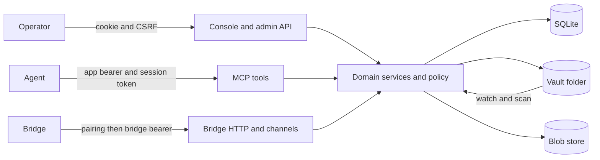

# Architecture

This page maps the platform's runtime boundaries and durable state. The [platform requirements](requirements.md) describe the contracts these boundaries support.

One Fastify process on Node.js 24 serves the console, MCP and bridge HTTP endpoints. SQLite in WAL mode stores policy, durable workflow state, audit records, and vault/graph metadata. The vault on disk owns the current note bytes; content-addressed blobs under the data directory preserve supported history and shares. The browser console is an admin API client.

| Boundary | Code and responsibility |
|---|---|
| Composition and lifecycle | [app.ts](../server/src/app.ts), [config.ts](../server/src/config.ts): routes, limits, startup recovery, maintenance, shutdown. |
| Authentication and policy | [keys](../server/src/keys/), [policy](../server/src/policy/), [access](../server/src/access/): agent and app credentials, deterministic decisions, permission catalogue, and temporary grants. Console accounts and project scope live in [admin](../server/src/admin/). |
| Entry points | [MCP](../server/src/mcp/), [admin](../server/src/admin/), [bridge HTTP](../server/src/bridge/): validate protocol inputs, identify actors, call services, format outcomes. |
| Collaboration and delivery | [messaging](../server/src/messaging/), [teams](../server/src/teams/), [shares](../server/src/shares/), [channels](../server/src/channels/): current access, task transitions, queued work, version manifests, transfer state. |
| Vault and derived data | [vault](../server/src/vault/), [graph](../server/src/graph/): resolve paths, read/write bytes, preserve revisions, derive provenance and queue curator work. |
| Operations | [safety](../server/src/safety/), [audit](../server/src/audit/), [database](../server/src/db/): lockdown, alerts, retention, versioned schema, and counters. |

For an agent call, authenticate the app at HTTP entry, validate the session token where required, check current credential state and lockdown, scan incoming data, then apply tool and resource checks in the appropriate handler. The wrapper records the result and checks for credentials in outbound content. Domain services also guard work that continues after the MCP request returns. In particular, bridge authentication alone never authorizes a vault write.

Messages have ordered room sequences and explicit cursors. The hub stores team work and its hand-off state. A connector can deliver queued work to an agent, and eligible legacy clients can pick it up through a bounded poll. The hub records acknowledgment separately. In-process wakeups and transfer buffers keep the deployment simple, but prevent independent replicas from behaving as one hub. Migrations in [db/migrations](../server/src/db/migrations/) define the schema; keep them append-only and test upgrades with representative state. See [authorization](authorization.md) for rule evaluation and [decisions](decisions/README.md) for tradeoffs.

## Durable data map

| State | Recovery boundary |
|---|---|
| Identity and policy | SQLite stores credentials, logins, rule versions, temporary grants and operator sessions. Restore the pepper with the database. |
| Collaboration | SQLite stores room sequences, login cursors, task transitions and turns, work items, questions, and checkout state. A new login has its own cursors. |
| Vault and shares | The vault holds live files. SQLite stores revisions, conflicts, write intents and share manifests. History and shares also need referenced blobs. |
| Transfers | SQLite stores metadata and offsets. Relay buffers are local to the process. Resume depends on the source remaining available to retransmit. |
| Project governance | SQLite stores Blueprint items and revisions, team ownership, proposals, and directive versions and confirmations. Project exports and hub-generated Markdown copies are derived records. |
| Knowledge | Sections and signals derive from notes. Evidence, review decisions and job state persist separately and cannot be recreated by a vault scan. |

Migrations start from `0100_v1_baseline.sql`. The runner checks applied migrations by checksum and can adopt the supported legacy schema. Keep applied migrations immutable and restore a compatible snapshot for rollback. See the [migration runner](../server/src/db/db.ts) and [upgrade procedure](getting-started.md#upgrading-to-10).
