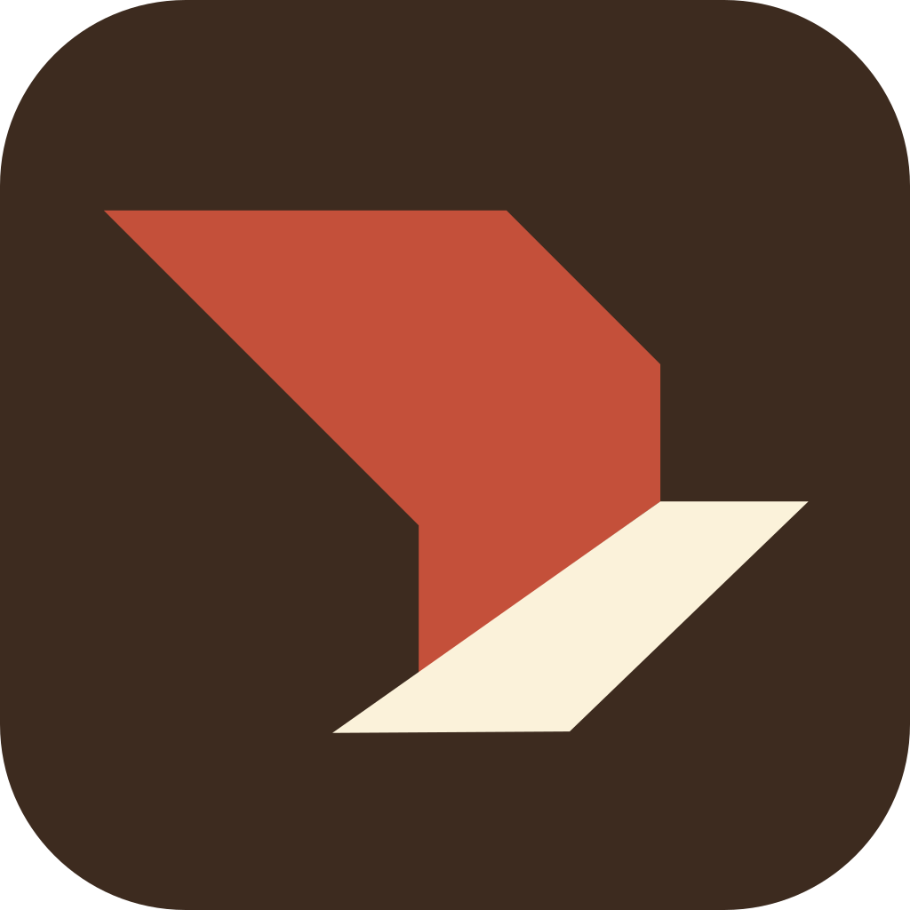

# Brand

## App icon

Source: [brand/conclave-icon.svg](brand/conclave-icon.svg). Use it for the app icon, the favicon and the logo mark beside the "Conclave" wordmark.

**What it means.** The terracotta fold captures the moment finished work slips into your Obsidian vault. One continuous shape changes direction at the crease, suggesting a handoff between agents. The cream face is the result they have reviewed and filed.

That is the part of Conclave the icon focuses on: work keeps moving while you step in only for the decisions that need you. The two broad planes and the sharp crease keep the silhouette recognizable at favicon size.

| Part | Colour |
|---|---|
| Tile | `#3D2B1F` dark brown (the site's ink) |
| Fold | `#C4503A` terracotta (the site's accent) |
| Face | `#FBF2DA` cream (the site's paper) |

The colours are the landing site's warm, flat palette, so the icon sits in the illustrations without standing out from them. The shape came first in violet on deep navy (`#7234FA`, `#D7CFFB` on `#070525`). That version is retired.

**Rules.** Keep the tile square and centred, with a corner radius of about 20 % of its side. Do not recolour the fold or the face, add text, outline the shapes or put effects on them. Below 32 px, keep the tile: the shapes need the dark ground to read.
